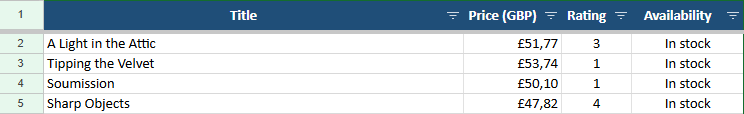

# E-commerce Price Tracker

A Python web scraping pipeline that collects product data from an online catalogue, cleans it, and delivers a ready-to-use Excel report.

## The Business Problem

Retailers and resellers need to watch competitor prices and stock, but checking product pages by hand is slow, error-prone, and hard to repeat. Copied data also tends to arrive messy, with currency symbols and inconsistent formats that block analysis.

This project automates that workflow from start to finish: one command crawls the whole catalogue and produces a clean, formatted spreadsheet. Each run saves a timestamped file, so snapshots can be compared to follow price changes over time.

It uses [Books to Scrape](http://books.toscrape.com), a public sandbox built for scraping practice, and the same approach can be adapted to other catalogue sites.

## Features

- **Full catalogue crawl:** follows pagination automatically, with an optional page limit.
- **Structured extraction:** captures title, price, availability, and star rating as a number from 1 to 5.
- **Data cleaning with pandas:** removes currency symbols, converts prices to `float`, normalizes text, and drops rows with invalid prices.
- **Formatted Excel output:** includes a styled header, currency format, frozen header row, filters, and set column widths.
- **Robust networking:** uses realistic HTTP headers, connect and read timeouts, and automatic retries with backoff on `429` and `5xx` responses.
- **Graceful failure handling:** skips malformed products and keeps collected data if a later page fails.
- **Clean console logs:** shows timestamped progress, warnings, and errors.
- **Polite by default:** waits between page requests, with a configurable delay.

## Project Structure

```text
ecommerce-price-tracker/
├── output/             # Generated Excel reports (created at runtime, not committed)
├── .gitignore
├── README.md
├── requirements.txt
└── scraper.py          # Scraping, cleaning, and export pipeline
```

## Installation and Usage

Requires Python 3.11 or newer.

**1. Clone the repository**

```bash
git clone https://github.com/<your-username>/ecommerce-price-tracker.git
cd ecommerce-price-tracker
```

**2. Create and activate a virtual environment**

macOS / Linux:

```bash
python3 -m venv venv
source venv/bin/activate
```

Windows (PowerShell):

```powershell
python -m venv venv
venv\Scripts\Activate.ps1
```

**3. Install the dependencies**

```bash
pip install -r requirements.txt
```

**4. Run the script**

```bash
python scraper.py
```

The report is saved as `output/books_<timestamp>.xlsx`.

### Command-Line Options

| Option | Description | Default |
| --- | --- | --- |
| `--url` | Catalogue URL to start from | `http://books.toscrape.com/` |
| `--max-pages` | Stop after this many pages | All pages |
| `--delay` | Seconds to wait between pages | `1.0` |
| `--output` | Output `.xlsx` path | `output/books_<timestamp>.xlsx` |

For a quick test run:

```bash
python scraper.py --max-pages 2 --output output/sample.xlsx
```

## Example Output

Each execution generates a styled, timestamped spreadsheet saved directly to the `output/` directory (e.g., `output/books_20261106_123800.xlsx`).

### Extracted Data Structure

| Title | Price (£) | Rating (1-5) | Availability |
| :--- | :---: | :---: | :---: |
| A Light in the Attic | £51.77 | 3 | In stock |
| Tipping the Velvet | £53.74 | 1 | In stock |
| Soumission | £50.10 | 1 | In stock |
| Sharp Objects | £47.82 | 4 | In stock |
| Sapiens: A Brief History of Humankind | £54.23 | 5 | In stock |

### Excel Spreadsheet Features
- **Formatted Headers:** Distinct navy background with bold, centered white labels.
- **Data Types:** Prices are converted to numeric floats and formatted as currency (`£#,##0.00`) for seamless formula calculations.
- **Usability:** Frozen top row for smooth scrolling and automatic auto-filters enabled across all columns.



## Console Logs

```text
2026-11-06 12:38:21 | INFO     | Page 36: 20 books (total: 720)
2026-11-06 12:38:30 | INFO     | Page 42: 20 books (total: 840)
2026-11-06 12:38:37 | INFO     | Page 47: 20 books (total: 940)
2026-11-06 12:38:40 | INFO     | Page 49: 20 books (total: 980)
2026-11-06 12:38:42 | INFO     | Page 50: 20 books (total: 1000)
2026-11-06 12:38:42 | INFO     | Saved 1000 books to output\books_20261106_123728.xlsx
```

## Tech Stack

- **Requests** and **urllib3** for HTTP, retries, and timeouts
- **Beautiful Soup** for HTML parsing
- **pandas** for data cleaning
- **openpyxl** for Excel output and formatting
